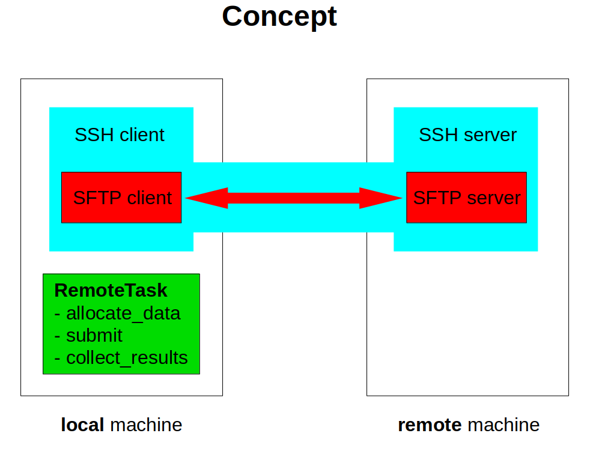

# Remote computation handler

`remote_handler` is a piece of code that is supposed to help streamlining active learning workflows. It uses the `paramiko` package to set up a ssh/sftp connection to a remote machine allowing for file transfers. Additionally, it handles job submissions via the remote machines slurm scheduler. I tried to write it in a modular way, such that it is quite flexible for setting up various active learning pipelines.



# Installation
If you want to set up a new python environment first, create a conda env, e.g.

```bash
conda create --name remote_handler python=3.10
```

Then move into the cloned repository and hit

`pip install -e .`


# Usage

## Getting started: configuration
There are essentially two things that need a tiny bit of configuration to let `remote_handler` work:
- SSH authentication
- SLURM setup

### SSH authentication

The ssh connection, which is required to use SFTP for file transfer, is managed by the `paramiko` package. To have as little additional configuration as possible required for the ssh setup, `remote_handler` parses your SSH config. To reach a remote machine like lugus, you therefore have to set up lugus as a host in your `.ssh/config` file and have key authentication enabled.

An entry like this with an appropriate key authentication setup should to the job.
```bash
host lugus
    User USERNAME
    HostName lugus.theochem.tuwien.ac.at
```

### SLURM setup
In case `remote_handler` is supposed to be used for running batch jobs via the SLURM scheduler on a cluster, we have to provide some information on the specific setup of SLURM on this cluster. Currently this is achieved by compact json files, which need to be provided. For example if you want to use slurm on lugus, a file `lugus.json` would require these entries:

```json
{
    "remote_machine": "lugus",
    "partition": "normal",
    "savepath": "/home/nunglert/dump/remote_handler",
    "conda_env": "cppjax",
    "template": "lugus.sh.j2"
}
```

This will probably undergo a few changes in the close future to make it more general for different systems. The idea at the moment is, to generate the required queuing scripts using `jinja2` templates. You may also want to specify a `REMOTE_HANDLER_SLURM_TEMPLATES` env variable, for more info see below.

## Manipulating files on remote machines

`FileSystemHandlerBase` defines an interface for manipulating files on a file system, like you are used to from manipulating files in a shell environment. Examples are 
- `makedirs(path, exist_ok=False)`: creates a directory at `path`
- `exists(path)`: checks whether path exists
- `remove(path)`: removes file at path 
- ...

`LocalFileSystem` implements all of this functionality for the local filesystem you are currently at. So basically this is a wrapper for file manipulation methods from `os` and `shutil`. The following snippet for example creates a directory `dir1` in your current directory, writes a file `file1` and creates a copy of that file `file2` in the same directory.

```python
from remote_handler import file_handler
from pathlib import Path

local_fs = file_handler.LocalFileSystem()
my_directory = Path("dir1")
local_fs.makedirs(my_directory, exist_ok=True)

my_file = my_directory / "file1"
with open(my_file, "w") as f:
    f.write("Interesting content")

local_fs.put(my_file, my_directory / "file2")
```

`RemoteFileSystem` now implements all of this logic also for a remote filesystem. Under the hood this is using the SFTP client implemented in `paramiko`, but the interface is exactly the same. If you properly configured SSH for lugus (see above), then the following should work:

```python
from remote_handler import file_handler
from pathlib import Path

local_fs = file_handler.RemoteFileSystem(remote_alias="lugus")
my_directory = Path("dir1")
local_fs.makedirs(my_directory, exist_ok=True)

my_file = my_directory / "file1"
with open(my_file, "w") as f:
    f.write("Interesting content")

local_fs.put(my_file, my_directory / "file2")
```

This creates the same folder structure in your lugus home!


## Running a task on a remote machine

### What is a task?
We define an interface for a task in `RemoteTask`. This is currently in progress and may change rapidly, but the idea is that we can define a task in an abstract fashion by only a few central logical constituents:
- Setup: Does the task require some script or input data that potentially needs to be transferred to the remote machine (`allocate_data`)?
- Execution: How is the computation executed? Do we run a batch job in slurm? Is it run locally?
- Result collection: Given that the job ran succesfully, what do we want to transfer back?
- (Error handling: Each task may have individual logic to check whether it ran succesfully and also what could be done if not)

Examples coming as soon as the implementation converges to sth sensible...

# How it works

## SLURM and jinja templates
We are automatically generating the queueing scripts for the desired remote system using jinja templates. This allows for piecing together the queuing scripts in a modular fashion. For example, for lugus a minimal template for the header could look like (see also `src/remote_handler/templates/lugus.sh.j2`):

```jinja
#!/bin/sh
#SBATCH --job-name={{ jobname }}
#SBATCH --ntasks={{ n_cores }} 
#SBATCH --partition={{ partition }}
{{ slurm_header_add }}

source /opt/ohpc/pub/anaconda3/etc/profile.d/conda.sh
conda activate {{ conda_env }}


```

The body of the queuing script, which is identically regardless of the particular queuing system, is then included using another jinja template, e.g. (see also `src/remote_handler/templates/body_single.sh.j2`):

```jinja
python {{ python_script_path }} {{ input_file }}
```

or for a more complex array job (see also `src/remote_handler/templates/body_array.sh.j2`):

```jinja
# Print the task and run range
echo This is task $SLURM_ARRAY_TASK_ID

MAP=({{ map_indices | join(' ') }})

# Get the mapped index for this SLURM array task
MAPPED_INDEX=${MAP[$SLURM_ARRAY_TASK_ID]}

PER_TASK=1

# Calculate the starting and ending values for this task
START_NUM=$(( ($SLURM_ARRAY_TASK_ID - 1) * $PER_TASK + 1 ))
END_NUM=$(( $SLURM_ARRAY_TASK_ID * $PER_TASK ))

# Print the task and run range
echo This is task $SLURM_ARRAY_TASK_ID, which will do runs $START_NUM to $END_NUM

# Run the loop of runs for this task
for (( run=$START_NUM; run<=END_NUM; run++ )); do
  echo This is SLURM task $SLURM_ARRAY_TASK_ID, run number $run
  run_id=$((run - 1))
  python {{ python_script_path }} {{ calcdir }}/$run_id
done
```

A few example templates are contained in `src/remote_handler/template`. You can add a custom path for your own templates by setting the environment variable

```bash
export REMOTE_HANDLER_SLURM_TEMPLATES=/path/to/your/templates
```


# Development
In order to use the development features, be sure you have installed the dev version.

```bash
`pip install -e .[dev]`
```

If you want to contribute to this repository, please adhere to the following rules. 

## Testing
Write proper tests for everything you implement. 

Run all tests via
```bash
pytest
```

Run a specific test with additional logging and stdout
```bash
pytest -k test_SingleScriptTask -s --log-cli-level info
```

## pre-commit hooks
Only push commits with pre-commit hooks enabled, to keep formatting as clean as possible. In the root directory use:

```bash
pre-commit install
```

which should install the hooks for you.


# TODOs

- Refine jinja templating procedure for slurm batch scripts
- Refine which parameters should be provided by config files `remote_machine.json`
- Come up with a unified way of handling conda/python environments on remote machine
- Clean code for command execution (currently only SLURM's sbatch is used) on remote machine 
- potentially extend functionality of FileHandler to also execute arbitray shell commands via subprocess
- While I like the overall class hierarchy and abstraction, the specific implementation is not very clean. Member variables are not handled with great care, leaving room for many potential failures if handled incorrectly. Needs some further thought, probably from someone who is good at OOP :v)
- Need more documentation